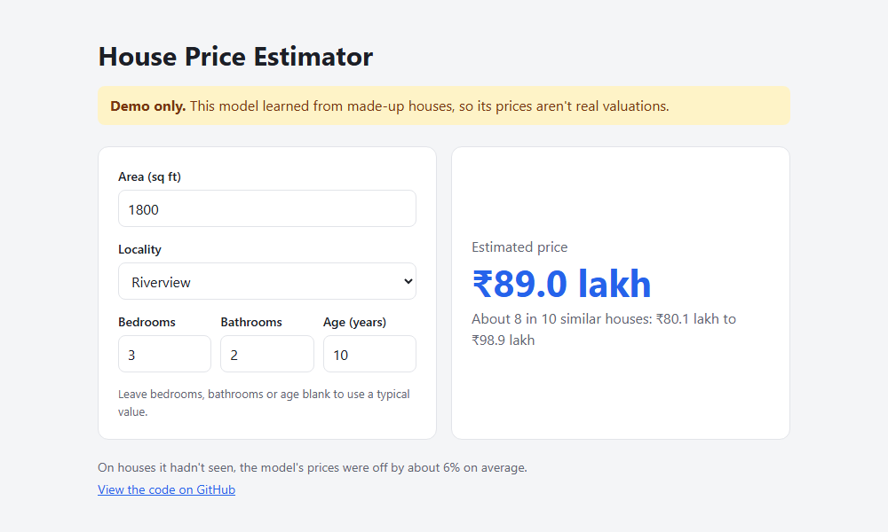
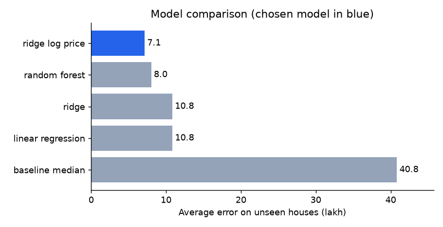
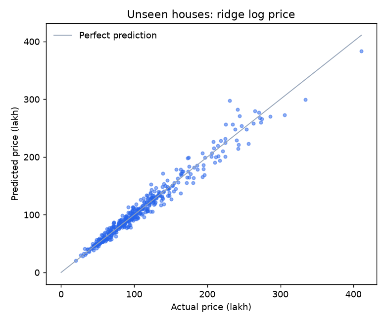

# House Price Prediction

[](https://github.com/Kishore-1011/House_Price_Prediction/actions/workflows/tests.yml)


**Live demo: https://kishore-1011.github.io/House_Price_Prediction/**

A complete machine learning workflow that estimates house prices: generate data, compare models, evaluate them on unseen houses, predict for a client's file, and serve the result on a web page.

> **The data is made up.** All 2,000 houses come from a formula in [`generate_data.py`](house_price/generate_data.py), and the neighbourhoods are invented. The prices and accuracy here show that the workflow functions. They say nothing about real property values.



## Results

Models are chosen by 5-fold cross-validation on the training houses. The other 400 houses are held back and used only for the final score.

| Model | Average error on unseen houses | Average error % | R² |
|---|---|---|---|
| **Ridge on log price (chosen)** | **₹7.1 lakh** | **6.4%** | **0.967** |
| Random forest | ₹8.0 lakh | 7.4% | 0.956 |
| Ridge | ₹10.8 lakh | 11.7% | 0.932 |
| Linear regression | ₹10.8 lakh | 11.7% | 0.932 |
| Baseline (always guess the median) | ₹40.8 lakh | 41.0% | -0.053 |





The log-price model wins partly because the made-up prices are built by multiplying factors together, which is the shape that model assumes. Real prices would be messier, so expect real-world accuracy to be lower.

## Run it

```bash
python -m venv .venv
.venv\Scripts\activate          # macOS/Linux: source .venv/bin/activate
pip install -r requirements-dev.txt

python -m house_price.generate_data   # create data/raw/housing.csv
python -m house_price.train           # compare models, save the best, write reports
python -m house_price.predict         # predict data/client/client_file.csv
pytest
```

To predict your own file:

```bash
python -m house_price.predict --input my_houses.csv --output my_prices.csv
```

The file needs these columns: `area`, `bedroom`, `bathroom`, `age` and `locality`. Blank bedrooms, bathrooms or ages are filled in automatically. Problems such as text in a number column stop with a message naming the spreadsheet row.

## How it works

- **Missing values** are filled with the median inside the pipeline, so test houses can't influence training.
- **Evaluation** compares every model against a baseline that always guesses the median price.
- **Model safety:** a saved model file can run code when loaded, so its SHA-256 checksum is verified first, and a warning appears if the scikit-learn version differs from the one used for training.
- **The web demo** runs without a server. Training exports the model's numbers to [`docs/model.js`](docs/model.js), and a test confirms the page's arithmetic matches the trained model.

## Project structure

```
House_Price_Prediction/
├── house_price/               # The pipeline
│   ├── config.py              # Paths and settings
│   ├── generate_data.py       # Creates the made-up dataset
│   ├── model.py               # Candidate models and scoring
│   ├── train.py               # Compares models and saves the best
│   ├── predict.py             # Checks a client's file and predicts prices
│   ├── storage.py             # Saves and safely loads the model
│   ├── export_web.py          # Exports the model for the web demo
│   └── reports.py             # Charts
├── notebooks/                 # Exploration and a walkthrough of predicting
├── data/                      # Training data, client file and predictions
├── models/                    # Saved model and its checksum
├── reports/                   # Metrics and charts
├── docs/                      # The web demo
└── tests/                     # Automated tests
```

## License

[MIT](LICENSE)
